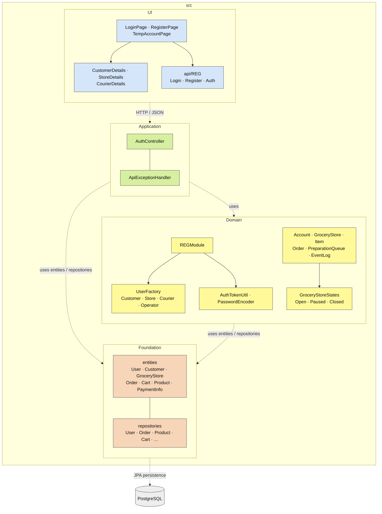

# ShopEasy Package Diagram

The UI box lists the routed React pages and registration details; the API client sends requests to `AuthController`. The `Browse.html`, `ManageAccount.html`, and `Order.html` files exist as static UI files but are not currently wired into the React router. The older `Domain` model classes are shown separately from the persisted `Foundation.entities` classes because both packages currently exist in the codebase.
